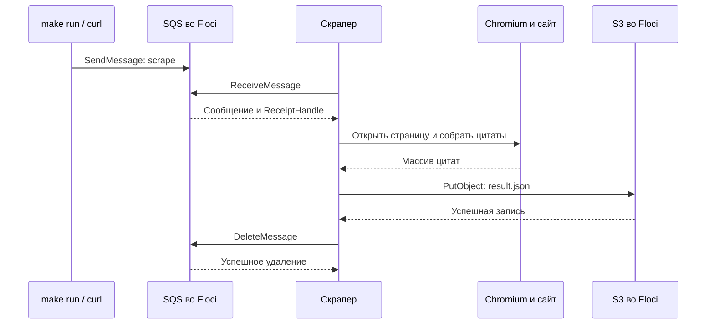

# Разбор лабораторной № 2: от сообщения в SQS до JSON в S3

Этот документ объясняет реализацию именно этого репозитория: JavaScript, Node.js, Playwright, системный Chromium, Floci, Terraform, Docker Compose и Make.

## Содержание

- [Общая задача и участники](#общая-задача-и-участники)
- [Один запуск от начала до конца](#один-запуск-от-начала-до-конца)
- [Что хранится в SQS и S3](#что-хранится-в-sqs-и-s3)
- [Сетевые адреса, протоколы и форматы](#сетевые-адреса-протоколы-и-форматы)
- [Как работает скрапер](#как-работает-скрапер)
- [Dockerfile и Compose](#dockerfile-и-compose)
- [Terraform и его файлы](#terraform-и-его-файлы)
- [Makefile и CI](#makefile-и-ci)
- [Сценарий проверки](#сценарий-проверки)
- [Ответы на вопросы защиты](#ответы-на-вопросы-защиты)
- [Ограничения реализации](#ограничения-реализации)
- [Официальные источники](#официальные-источники)

## Общая задача и участники

Нужно по заданию собрать цитаты с сайта и сохранить результат. Очередь отделяет момент отправки задания от его выполнения, а объектное хранилище хранит полученные данные.

| Участник | Что делает |
|---|---|
| `make run` и `curl` | Отправляют сообщение с заданием |
| SQS | Хранит сообщения, выдаёт их обработчику |
| Скрапер, `src/scrape.js` | Получает задание и организует выполнение |
| Node.js | Исполняет JavaScript приложения |
| Playwright | Позволяет коду управлять браузером |
| Chromium | Загружает сайт и выполняет его JavaScript |
| S3 | Хранит JSON с результатом |
| Floci | Воспроизводит необходимые API AWS локально, в том числе S3 и SQS |
| Terraform | Создаёт и учитывает бакет и очередь |
| Docker | Собирает образы и запускает контейнеры |
| Docker Compose | Описывает сервисы, общую сеть и настройки контейнеров |
| Makefile | Объединяет команды в воспроизводимые действия |
| GitHub Actions | Автоматически запускает `make ci` |

Floci не пересылает эти запросы в Amazon: локальный эмулятор сам обслуживает их. Настоящий аккаунт AWS не нужен. Terraform работает с API через AWS provider — плагин, преобразующий действия Terraform в запросы к сервисам.

Без Terraform бакет и очередь можно было бы создавать отдельными API-командами. Terraform сохраняет описание нужной инфраструктуры в файлах, вычисляет изменения и учитывает созданные объекты.

## Один запуск от начала до конца

Подготовка и выполнение — разные этапы.

```text
make deploy
    ├── make build: собрать образ скрапера
    ├── make provision
    │   ├── запустить Floci
    │   ├── подготовить Terraform
    │   └── создать бакет и очередь
    ├── получить имя бакета и URL очереди из Terraform outputs
    └── запустить скрапер с параметрами подключения

make run
    ├── отправить сообщение scrape в SQS
    └── дождаться завершения обработки и проверить JSON в S3
```

После `make deploy` скрапер уже работает, но ждёт сообщение. При обычном последовательном запуске Make сначала выполняет `build`, затем `provision`; обе зависимости завершаются до запуска приложения. Параллельный запуск через `make -j` здесь не требуется.



S3 и SQS напрямую не передают друг другу данные в этой реализации. Последовательность организует скрапер.

## Что хранится в SQS и S3

### SQS: что нужно сделать

SQS — очередь сообщений. В этой лабораторной сообщение имеет тело `scrape`, то есть служит сигналом начать сбор цитат.

Формирование и отправка находятся в цели `run` файла [Makefile](Makefile):

```makefile
curl -fsS -X POST "$$queue" \
    -H 'Content-Type: application/x-www-form-urlencoded' \
    --data-urlencode 'Action=SendMessage' \
    --data-urlencode 'Version=2012-11-05' \
    --data-urlencode 'MessageBody=scrape';
```

Это фрагмент shell-команды внутри рецепта Make. В настоящем Makefile строка рецепта начинается с табуляции.

- `curl` отправляет сетевой запрос.
- `-X POST` задаёт HTTP-метод.
- `$$queue` после обработки Make становится shell-переменной `$queue` с адресом очереди.
- `Action=SendMessage` выбирает операцию SQS «добавить сообщение».
- `MessageBody=scrape` задаёт содержимое сообщения.
- `--data-urlencode` кодирует и добавляет поля в тело запроса.
- `Version=2012-11-05` — версия API, а не дата запуска лабораторной.

Код JavaScript не отправляется в очередь. Он уже находится в образе скрапера. Более того, скрапер сейчас не читает `message.Body`: любое полученное сообщение запускает один и тот же алгоритм. Строка `scrape` не выбирает обработчик и не является выполняемой shell-командой.

### S3: что получилось

S3 — объектное хранилище. Bucket, буквально «ведро», — именованный контейнер для объектов. Бакетов может быть несколько; каждый может содержать много объектов.

```text
S3
├── бакет quotes-results
│   └── объект с ключом result.json
└── другой бакет, если его создать отдельно
    ├── photo.jpg
    └── backup.zip
```

В проекте Terraform создаёт один бакет `quotes-results`. Скрапер записывает туда объект с ключом `result.json`.

Ключ — имя объекта внутри бакета. Например, `results/2026-11-05/result.json` тоже мог бы быть ключом целиком. В обычной модели S3 `/` образует условные префиксы, а не настоящую файловую иерархию.

Объект содержит данные и метаданные. Данные могут быть произвольными байтами: JSON, CSV, изображением, архивом. Расширение `.json` само по себе не проверяет формат.

Пример содержимого нашего объекта:

```json
[
  {
    "text": "Пример цитаты",
    "author": "Автор",
    "tags": ["example"]
  }
]
```

Базовые правила: ключ чувствителен к регистру и ограничен 1024 байтами UTF-8. Для обычного имени бакета действуют отдельные ограничения: 3–63 символа, строчные латинские буквы, цифры, дефисы и точки, а также дополнительные правила AWS.

Terraform создаёт пустые ресурсы. `make run` добавляет сообщение в очередь. Скрапер добавляет результат в бакет. Это три разных действия.

## Сетевые адреса, протоколы и форматы

| Значение | Назначение |
|---|---|
| `http://localhost:4566` | Floci с компьютера, где выполняются Terraform и curl |
| `http://floci:4566` | Floci из контейнера скрапера через сеть Compose |
| `http://floci:4566/000000000000/quotes-jobs` | Адрес конкретной очереди внутри сети Compose |
| `quotes-results` | Имя бакета, не адрес сервера |
| `result.json` | Ключ объекта в бакете |
| `https://quotes.toscrape.com/scroll` | Сайт, с которого собираются цитаты |

`localhost` означает собственное сетевое окружение вызывающей программы. В контейнере скрапера это сам контейнер, поэтому соседний сервис доступен по имени `floci`. Docker Compose обеспечивает обнаружение сервисов по их именам в общей сети.

HTTP описывает обмен запросами и ответами: метод, путь, заголовки, тело и статус ответа. TCP доставляет упорядоченный поток байтов. Локальные HTTP-запросы к Floci передаются по TCP. HTTPS защищает HTTP-обмен с помощью TLS: шифрует соединение и проверяет сертификат сервера. Для распространённого HTTPS через TCP цепочка слоёв — HTTP → TLS → TCP; существуют и другие транспортные варианты HTTPS.

У приложения Floci выбран HTTP для простого локального подключения без настройки TLS. Сайт цитат открывается по HTTPS. Настоящие AWS endpoints обычно используются по HTTPS, с действительными учётными данными и правами доступа.

Совместимость API означает, что эмулятор понимает необходимые операции и форматы запросов AWS. У разных сервисов AWS разные соглашения поверх HTTP/HTTPS; «AWS API» не означает один универсальный формат тела запроса.

| Обращение в этом проекте | Оформление |
|---|---|
| `curl` → SQS: отправить сообщение | HTTP POST, поля формы; ответ XML |
| SQS SDK → Floci: получить или удалить сообщение | HTTP POST, AWS JSON protocol |
| S3 SDK → Floci: записать объект | HTTP PUT, тело содержит текст JSON |
| `curl` → S3: прочитать результат | HTTP GET, ответ содержит JSON |
| Chromium → сайт | HTTPS, загрузка HTML и других ресурсов |
| JavaScript сайта → `/api/quotes?page=...` | Подгрузка данных цитат в JSON |

Один сервер Floci может принимать несколько форматов: он выбирает обработку по методу, пути, заголовкам и параметрам.

Схематичный запрос получения сообщения через SDK, без подписи и прочих служебных заголовков:

```http
POST / HTTP/1.1
Host: floci:4566
Content-Type: application/x-amz-json-1.0
X-Amz-Target: AmazonSQS.ReceiveMessage

{"QueueUrl":"http://floci:4566/000000000000/quotes-jobs","WaitTimeSeconds":10}
```

`POST` — HTTP-метод. `ReceiveMessage` — операция API. JSON — формат параметров. Для удаления сообщения SQS также использует операцию в POST-запросе, а не обязательно HTTP DELETE.

Запись результата в S3 схематично выглядит так:

```http
PUT /quotes-results/result.json HTTP/1.1
Host: floci:4566
Content-Type: application/json

[{"text":"Пример","author":"Автор","tags":[]}]
```

SDK, то есть библиотека для работы с API, формирует сетевые запросы, подписывает их и разбирает ответы. Программа вызывает удобные JavaScript-методы вместо ручной сборки HTTP.

## Как работает скрапер

### Чтение конфигурации

[src/scrape.js](src/scrape.js) получает настройки через переменные окружения:

```js
endpoint: requireEnv("AWS_ENDPOINT_URL"),
bucket: requireEnv("BUCKET_NAME"),
queueUrl: requireEnv("QUEUE_URL"),
```

`requireEnv()` читает `process.env[name]` и выдаёт ошибку, если значение отсутствует. `clientOptions(config)` передаёт endpoint, регион и учётные данные клиентам `S3Client` и `SQSClient`. Само создание клиента ещё не отправляет сообщение: запрос выполняется при `.send()`.

Приложение не читает `provider.tf`. Его endpoint приходит из Compose. Адрес в `provider.tf` используется отдельной программой Terraform. Один код приложения можно направить в другое окружение, передав другие параметры без изменения JavaScript.

### Получение сообщения

```js
const message = await receiveJob(sqs, config.queueUrl);
if (!message) {
  continue;
}
await handleJob(config, s3, sqs, message);
```

`receiveJob()` отправляет `ReceiveMessageCommand`. Скрапер сам опрашивает SQS: очередь не устанавливает новое соединение к скраперу для передачи команды.

Параметры запроса: максимум одно сообщение, long polling до 10 секунд и visibility timeout 180 секунд. Если очередь пуста, запрос может ждать до 10 секунд, а затем цикл делает следующий запрос. Если сообщение появляется раньше, ответ может прийти раньше.

После получения сообщение временно скрыто, но ещё не удалено. `ReceiptHandle` выдаётся для полученной доставки сообщения и нужен для её удаления.

### Выполнение и подтверждение

```js
const quotes = await scrapeQuotes();
await saveToBucket(s3, config.bucket, quotes);
await deleteJob(sqs, config.queueUrl, message.ReceiptHandle);
```

`await` означает ожидание завершения операции в текущей асинхронной функции. Если сбор или запись бросает исключение, до удаления сообщения выполнение не доходит.

| Функция | С чем работает | Результат |
|---|---|---|
| `scrapeQuotes()` | Playwright, Chromium и сайт | Массив JavaScript в памяти |
| `saveToBucket()` | Клиент S3 и бакет | Объект в S3 |
| `deleteJob()` | Клиент SQS и очередь | Удалённое сообщение |

При сбое сообщение снова становится доступным после истечения visibility timeout, если не истёк срок его хранения. Если запись в S3 прошла, а удаление сообщения не удалось, возможна повторная обработка: здесь нет гарантии «ровно один раз».

### Сбор данных браузером

```js
const browser = await chromium.launch({
  headless: true,
  executablePath: process.env.CHROMIUM_PATH || "/usr/bin/chromium",
});
```

Playwright запускает установленный через APT системный Chromium. `headless` означает работу без видимого окна. Адрес сайта заранее записан в `TARGET_URL`, поэтому в сообщении его нет.

```js
await page.goto(TARGET_URL, { waitUntil: "networkidle" });
await page.waitForSelector(".quote", { timeout: 15000 });
await loadAllQuotes(page);
const quotes = await extractQuotes(page);
```

Сайт загружает цитаты JavaScript-запросами. Поэтому Chromium исполняет код страницы, а скрапер прокручивает её для подгрузки. `page.evaluate()` выполняет функцию внутри браузерной страницы. CSS-селектор `.quote` выбирает элементы с классом `quote`; внутри них извлекаются `.text`, `.author` и `.tag`.

`?.` позволяет безопасно обратиться к необязательному значению, `?? ""` подставляет пустую строку при `null` или `undefined`, `.trim()` убирает пробелы по краям. Браузер закрывается в `finally` после создания страницы даже при ошибке дальнейшей работы.

### Сохранение

```js
new PutObjectCommand({
  Bucket: bucket,
  Key: OBJECT_KEY,
  Body: JSON.stringify(quotes, null, 2),
  ContentType: "application/json",
})
```

`JSON.stringify()` превращает массив в текст; `2` задаёт отступы. Ключ `OBJECT_KEY` равен `result.json`, поэтому новый успешный запуск заменяет объект под тем же ключом. `forcePathStyle` выбирает адрес вида `/бакет/ключ`. Настройки checksum в коде ограничивают необязательные проверки совместимости с локальным эмулятором; они не превращают HTTP в HTTPS.

## Dockerfile и Compose

Образ — подготовленный набор файлов и настроек. Контейнер — запущенный экземпляр образа. На Mac Linux-контейнеры обслуживает Linux-среда Docker Desktop.

В [Dockerfile](Dockerfile) две стадии:

```dockerfile
FROM node:22-bookworm AS deps
WORKDIR /app
COPY package.json package-lock.json ./
RUN npm ci
```

Первая устанавливает JavaScript-зависимости из lock-файла. Вторая подготавливает рабочий образ:

```dockerfile
FROM node:22-bookworm AS runtime
WORKDIR /app
ENV NODE_ENV=production

RUN apt-get update && apt-get install -y --no-install-recommends \
    chromium \
    ca-certificates \
    && rm -rf /var/lib/apt/lists/*
```

`apt-get` — инструмент APT для системных пакетов Debian. `update` обновляет списки пакетов, `install` устанавливает Chromium и сертификаты. `-y` подтверждает установку, `--no-install-recommends` исключает необязательные рекомендуемые пакеты. Списки пакетов удаляются в том же слое для сокращения размера образа. Для скриптов Debian рекомендует специализированные инструменты вроде `apt-get`.

Далее зависимости копируются из стадии `deps`, затем копируется `src`. `CMD ["node", "src/scrape.js"]` задаёт запуск приложения. `RUN` выполняется при сборке, `CMD` — при запуске контейнера. Две стадии сами по себе не гарантируют маленький образ: здесь обе основаны на полном `node:22-bookworm`.

В команде `docker build -t quotes-scraper .` точка означает текущую папку как контекст сборки. Файлы из неё доступны инструкциям `COPY`, но не копируются автоматически целиком. `.dockerignore` исключает ненужные и локальные файлы, в том числе state, из контекста.

В [compose.yaml](compose.yaml) сервис Floci публикует порт `4566:4566`: порт компьютера → порт контейнера. Скрапер подключается по имени `floci` через общую сеть.

```yaml
profiles: ["app"]
```

`app` — произвольное имя профиля. Он позволяет не включать скрапер при подготовке инфраструктуры и включить его при deploy. Явное указание сервиса в команде Compose тоже может активировать его без отдельного флага профиля. Профиль не проверяет существование очереди: необходимый порядок задаёт Makefile.

`depends_on: floci` описывает зависимость сервисов, но сам по себе не создаёт бакет и очередь. `restart: unless-stopped` позволяет перезапустить завершившийся процесс. При ошибке получения сообщения процесс скрапера может завершиться, после чего Compose-политика перезапуска его поднимет.

## Terraform и его файлы

Terraform — отдельная программа управления инфраструктурой по описанию. `.tf` — файлы на языке конфигурации HCL. Они читаются совместно, а не исполняются как скрипты по именам файлов.

| Файл | Смысл |
|---|---|
| `infra/versions.tf` | Terraform не ниже 1.5, AWS provider ветки 6.x |
| `infra/provider.tf` | Подключение Terraform к локальному Floci |
| `infra/variables.tf` | Входные имена бакета и очереди |
| `infra/main.tf` | Объявления двух ресурсов |
| `infra/outputs.tf` | Выходные имя бакета и URL очереди |
| `infra/.terraform.lock.hcl` | Зафиксированная версия и контрольные суммы provider |
| `infra/terraform.tfstate` | Локальный учёт управляемых объектов; не коммитится |

```hcl
resource "aws_s3_bucket" "results" {
  bucket        = var.bucket_name
  force_destroy = true
}

resource "aws_sqs_queue" "jobs" {
  name = var.queue_name
}
```

`results` и `jobs` — имена внутри Terraform. `quotes-results` и `quotes-jobs` — фактические имена ресурсов во Floci. Ресурсом здесь называется объект инфраструктуры, которым управляет Terraform. Результат `result.json` является объектом S3, но отдельным Terraform-ресурсом в этой конфигурации не объявлен.

`force_destroy = true` разрешает удалить содержимое бакета при уничтожении самого бакета. Ничего немедленно при чтении файла не удаляется. Без этой настройки `make destroy` после записи результата может получить `BucketNotEmpty`. Настройка подходит данному учебному бакету; при destroy его результаты будут удалены.

### State, plan и apply

State связывает адрес `aws_s3_bucket.results` с конкретным бакетом. Он не заменяет S3 и не хранит вместо бакета собранные цитаты.

```text
Первый запуск:
  Конфигурация: нужны бакет и очередь.
  Floci: их нет.
  Plan: создать два ресурса.
  Apply: отправить запросы создания и сохранить состояние.

Повторный запуск:
  Конфигурация: нужны те же бакет и очередь.
  Floci: ресурсы существуют с нужными настройками.
  Plan: No changes.
```

Обычный plan сопоставляет конфигурацию, state и актуальные сведения от provider. Изменение в обход Terraform называется drift: например, после ручного удаления управляемой очереди следующий plan предложит её создать.

| Команда Terraform | Что делает |
|---|---|
| `init` | Подготавливает рабочую директорию, backend и provider |
| `fmt -check` | Проверяет форматирование |
| `validate` | Проверяет конфигурацию, а не работу скрапера |
| `plan` | Показывает предполагаемые изменения |
| `apply` | Выполняет изменения |
| `output -raw ...` | Читает объявленное выходное значение из state |
| `destroy` | Удаляет управляемые ресурсы |

Эти команды встроены в программу Terraform. В Makefile записано, когда их вызывать. `-chdir=infra` указывает рабочую директорию конфигурации.

State не пушат в Git: он может содержать секреты, отражает текущее окружение и не предназначен для обычного слияния Git. Пометка `sensitive` не гарантирует отсутствия значения в state. Git сохраняет предыдущие версии, включая случайно опубликованные секреты. State нужен, поэтому произвольно удалять его нельзя. В командной работе его обычно хранят отдельно, с контролем доступа и блокировкой изменений.

### Передача outputs приложению

В `outputs.tf` объявлено:

```hcl
output "bucket_name" {
  value = aws_s3_bucket.results.bucket
}

output "queue_url" {
  value = aws_sqs_queue.jobs.url
}
```

Makefile получает значения, а URL для хоста адаптирует к сети контейнеров:

```makefile
bucket=$$(terraform -chdir=infra output -raw bucket_name); \
queue=$$(terraform -chdir=infra output -raw queue_url); \
queue=$$(printf '%s' "$$queue" | sed 's#://localhost:#://floci:#'); \
```

Затем передаёт `BUCKET_NAME` и `QUEUE_URL` команде Compose. В `compose.yaml` они попадают в `environment` контейнера. Endpoint приложения задан там же как `AWS_ENDPOINT_URL`; endpoint самого Terraform находится отдельно в `provider.tf`.

## Makefile и CI

Все штатные действия выполняются из корня репозитория через Make:

| Команда | Результат |
|---|---|
| `make build` | Образ `quotes-scraper` |
| `make provision` | Floci, бакет и очередь |
| `make deploy` | Сборка, provision и запуск скрапера с настройками |
| `make run` | Одно сообщение, ожидание обработки и проверка JSON |
| `make ci` | Terraform fmt, init, validate и plan с работающим Floci |
| `make destroy` | Удаление ресурсов и остановка сервисов, включая профиль `app` |
| `make clean` | Попытка удалить образ и удаление локального `out/` |

`set -eu` в deploy/run останавливает shell при необработанной ошибке команды или обращении к неопределённой переменной. Оно не заменяет проверку всех элементов pipeline. Чтение URL Terraform отделено от `sed`, чтобы ошибка чтения не скрылась успехом последней команды pipeline.

`$$` нужен, чтобы Make передал `$` оболочке. `$(IMAGE)` — переменная Make, а `$$(команда)` после обработки Make становится shell-подстановкой вывода команды. Обратный слеш в конце строки продолжает её; пробел после него ломает продолжение. Перед командами рецепта нужна табуляция.

`make run` сравнивает число строк успешной обработки в логах до и после отправки и ждёт до 40 раз по 2 секунды, не считая накладных расходов команд. Затем скачивает `result.json` и проверяет, что это непустой JSON-массив. Такая проверка рассчитана на одиночный демонстрационный запуск без параллельных заданий.

В `.github/workflows/ci.yml` GitHub Actions получает код, устанавливает Terraform 1.17.0 и вызывает `make ci`. Зелёный CI подтверждает эти проверки, но не весь путь браузера и очереди. Для него нужен отдельный запуск `make deploy` и `make run`.

## Сценарий проверки

В отдельном учебном окружении, где результаты можно удалить:

```bash
make provision
make provision
make deploy
make run
make ci
make destroy
make destroy
```

Ожидания:

- первый provision создаёт два ресурса; повторный сообщает `No changes`;
- deploy запускает скрапер с непустыми параметрами;
- run отправляет одно сообщение, получает непустой JSON и завершается успешно;
- после обработки очередь не содержит доступных и обрабатываемых сообщений;
- destroy удаляет непустой бакет и очередь, затем контейнеры;
- повторный destroy завершается без ошибки и тоже оставляет окружение выключенным;
- state, `.terraform/`, секреты и `out/` отсутствуют среди отслеживаемых файлов;
- PR `feat/terraform-infra` → `main` остаётся открытым, CI проверяется именно на последнем коммите.

Штатный run проверяет успешную обработку по логам; независимая диагностика очереди может дополнительно читать её атрибуты. Диагностические API-вызовы не подменяют требуемые команды Make на защите.

Если появляется `no such object: quotes-worker`, скрапер не создан или удалён: сначала нужен `make deploy`. Если `ENOTFOUND floci`, нужно проверить, существует ли Floci в общей сети; запускать штатное окружение следует через Make. `BucketNotEmpty` при destroy указывает на невозможность удалить бакет с объектами без соответствующей настройки очистки. После destroy перед новым run снова нужен deploy.

Фактический итог проверки перед коммитом записывается ниже отдельно от ожидаемого поведения.

### Фактическая проверка 05.11.2026

Проверен текущий код в отдельной копии с пустым локальным state и отдельным Compose-проектом. Для изоляции изменены только имена тестового образа и контейнера скрапера. Использованы локальный кеш provider и кеш слоёв Docker; установка всех зависимостей с нуля без кешей не проверялась. State рабочего проекта не удалялся.

| Проверка | Наблюдавшийся результат |
|---|---|
| Первое `make provision` | Созданы бакет и очередь: `2 added` |
| Повторный provision в составе `make deploy` | `No changes`, `0 added, 0 changed, 0 destroyed` |
| `make deploy` | Образ собран, скрапер запущен с Terraform outputs |
| JavaScript и Chromium | `node --check` успешен; Chromium доступен в `/usr/bin/chromium`, пакет подтверждён через `dpkg-query` |
| `make run` | Успешно, `quotes: 100` |
| Независимое чтение S3 | 100 непустых цитат с авторами и массивами тегов, 100 уникальных пар текст/автор |
| Независимое чтение SQS | 0 доступных и 0 обрабатываемых сообщений |
| `make ci` | fmt и validate успешны, plan: `No changes` |
| Первый `make destroy` | Удалены оба ресурса, включая бакет с результатом, и оба контейнера |
| Повторный `make destroy` | Успешно, `0 destroyed`, Floci остановлен и удалён |
| Git и оформление | Lock-файл отслеживается; state, `.terraform/`, `.env`, `out/` не отслеживаются; `git diff --check` успешен |
| PR | На момент проверки открыт [PR № 2](https://github.com/zse7/devops-labs/pull/2), `feat/terraform-infra` → `main`, не смержен |

Состояние удалённого CI нужно проверять в Checks PR именно для последнего отправленного коммита; локальный успешный `make ci` не заменяет эту проверку. Приём первой лабораторной преподавателем и итоговая оценка здесь не подтверждаются. `make clean` в этом прогоне отдельно не запускался.

## Ответы на вопросы защиты

### Где Terraform хранит состояние и зачем оно нужно?

В этом проекте локально, в `infra/terraform.tfstate`. Оно связывает блоки ресурсов с реальными объектами и хранит сведения для управления ими. Например, `aws_s3_bucket.results` соответствует `quotes-results`. Актуальность ресурсов дополнительно проверяется через provider.

### Чем plan отличается от apply? Что показывает повторный plan?

Plan показывает предполагаемые действия, apply выполняет их. После успешного применения, если управляемые ресурсы совпадают с конфигурацией, повторный plan показывает `No changes`. Это не проверка работоспособности браузера или полноты цитат.

### Как приложение находит SQS и S3? Почему endpoint нельзя зашивать в код?

Endpoint, регион, учётные данные, имя бакета и URL очереди поступают через переменные окружения. Makefile читает имя бакета и URL очереди из Terraform outputs. Compose передаёт параметры контейнеру. Адрес в `provider.tf` нужен Terraform, скрапер этот файл не читает. Вынос endpoint из JavaScript позволяет менять подключение без изменения исходников и пересборки приложения.

### Какая зависимость есть между скрапером, очередью и bucket? Где она выражена?

Для успешной обработки скраперу нужны существующие очередь и бакет. `deploy` зависит от `provision`, затем получает outputs и запускает приложение. В Compose есть `depends_on: floci`, но создание ресурсов и их готовность обеспечиваются завершившимся Terraform apply. Сам `depends_on` бакет и очередь не создаёт.

### Почему сообщение удаляется из SQS только после записи результата в S3?

Чтобы ошибка сбора или сохранения не приводила к потере задания. При ошибке до DeleteMessage сообщение остаётся и после visibility timeout может быть получено повторно. При сбое удаления после успешной записи также возможна повторная обработка, поэтому это не гарантия выполнения ровно один раз.

### Что произойдёт, если ресурс изменить в обход Terraform?

Возникнет drift — расхождение фактического состояния и конфигурации. Следующий обычный plan может предложить вернуть настройку или восстановить удалённый объект. Ресурсами здесь являются бакет и очередь; `result.json` не описан отдельным Terraform-ресурсом, поэтому его содержимым Terraform не управляет.

### Какие файлы Terraform можно коммитить, а какие нельзя?

Коммитятся `.tf` и `.terraform.lock.hcl`. Не коммитятся `.terraform/`, state и резервные копии, секреты и локальные планы. По заданию также исключается `out/`. Lock-файл provider и state — разные файлы: первый фиксирует зависимость, второй учитывает инфраструктуру.

### Что AI-агент сделал не так с первого раза и как вы это заметили?

В проверенной реализации destroy падал после успешного run: S3 возвращал `409 BucketNotEmpty`, потому что в бакете оставался результат. Также `docker compose down` без профиля `app` оставлял контейнер скрапера. Это обнаружено реальным прогоном и проверкой контейнеров. Исправления: `force_destroy = true` и очистка с `--profile app`. Позже при редактировании после `\` появился пробел и сломал deploy; его убрали и повторно проверили запуск. Не следует приписывать агенту изменения, происхождение которых не подтверждено.

## Ограничения реализации

- Текст сообщения не разбирается: любой полученный элемент запускает один алгоритм для фиксированного сайта.
- Один ключ `result.json` хранит последний результат, а не историю запусков.
- Нет связи результата с уникальным идентификатором задания; проверка по логам не рассчитана на параллельные демонстрации.
- Остановка прокрутки опирается на паузу 800 мс и отсутствие прироста элементов. При медленной подгрузке возможен неполный результат. Даже успешный JSON не доказывает полноту; наблюдавшиеся 100 цитат — результат конкретного запуска.
- Пустой массив отклоняется, но строгой проверки всех полей каждой цитаты в runtime нет.
- Нет продления visibility timeout для очень долгой обработки, DLQ и гарантии «ровно один раз».
- Playwright использует системный Chromium; совместимость с любой будущей версией браузера не гарантирована.
- В Compose явно не заданы режим хранения и именованный том Floci. Рассчитывать на перенос данных в новый контейнер нельзя. Локальный state сам ресурсы не восстанавливает без Terraform apply.
- Учебная проверка не подтверждает полную совместимость с настоящим AWS или production-готовность.

## Официальные источники

- [Задание лабораторной № 2](https://effectivegarden.notion.site/amcs-devops-2026?p=3f1c8889e4c881198191d643183b8583&pm=s)
- [Floci](https://floci.io/floci/)
- [SQS: JSON protocol](https://docs.aws.amazon.com/AWSSimpleQueueService/latest/SQSDeveloperGuide/sqs-making-api-requests-json.html)
- [SQS: visibility timeout](https://docs.aws.amazon.com/AWSSimpleQueueService/latest/SQSDeveloperGuide/sqs-visibility-timeout.html)
- [S3: объекты](https://docs.aws.amazon.com/AmazonS3/latest/userguide/UsingObjects.html)
- [S3: ключи](https://docs.aws.amazon.com/AmazonS3/latest/userguide/object-keys.html)
- [Terraform plan](https://developer.hashicorp.com/terraform/cli/commands/plan)
- [Docker Compose: сеть](https://docs.docker.com/compose/how-tos/networking/)
- [Docker Compose: профили](https://docs.docker.com/compose/how-tos/profiles/)
- [Docker: контекст сборки](https://docs.docker.com/build/concepts/context/)
- [Debian: APT и использование в скриптах](https://manpages.debian.org/bookworm/apt/apt.8.en.html)
- [Playwright: запуск браузера и executablePath](https://playwright.dev/docs/api/class-browsertype#browser-type-launch)
